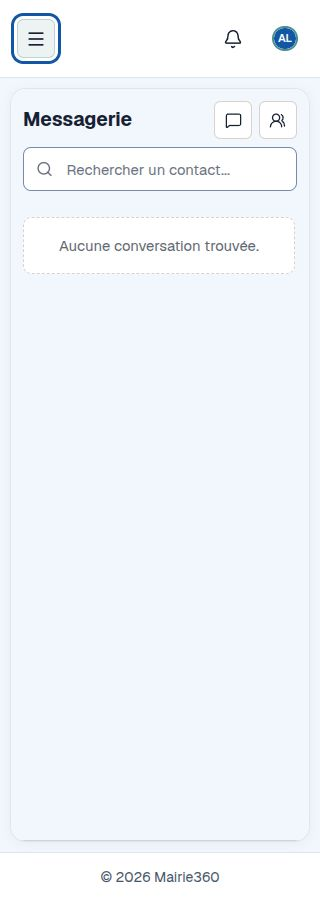

# Messages — direction visuelle commune, 14 octobre 2026

[MAIR-547](https://mairie-360.atlassian.net/browse/MAIR-547) décline l’option 1 retenue dans [MAIR-544](https://mairie-360.atlassian.net/browse/MAIR-544). DA claire commune : Geist, fond bleu clair, sidebar sombre, accent bleu, surfaces blanches et radius 16 px. Les dispositions métier existantes sont conservées.

Le thème `src/app/municipal-theme.css` est identique à celui des sept autres fronts et au canonique `src/styles/municipal-theme.css` de lib-components, SHA-256 `0aeeb52583b59c2c05527722c1b6c171152d282b612ddbdf469216a2f5d1edb6`. Consommation exacte de la version publiée 0.8.0 ; wrapper local de compatibilité pour le lien d’évitement, l’unicité de main et le pied de page hors aside. Remplacer ce wrapper lors de la consommation d’une prochaine version intégrant les corrections partagées.

Vérification : 296 tests Node, types, lint et build de production réussis. Capture native mobile 320 × 900 ; compte et données fictifs, aucune adaptation locale des cookies/du transport publiée. Les parcours déployés restent à vérifier avec un compte dev utilisable.

Police, rythme, couleurs, logo/Avatar et texte ont été contrôlés. Paramètres et Dashboard ont été comparés à leur référence dans une même entrée à 1487 × 1058 ; les autres modules reprennent les tokens et la navigation en conservant leurs contenus et grilles. Les contrastes ont été renforcés : sous-titre/fond 7,02:1, contour de champ/fond 3,32:1 ; focus visible et réduction des animations.

Cette réception visuelle ne certifie pas le RGAA global. Lecteur d’écran, thème sombre complet, parcours non capturés et recette déployée restent ouverts. MAIR-548 à MAIR-551 gardent leurs critères distincts ; aucune clôture par assimilation à la DA. Les limites backend restent présentées sans succès fictif. La bibliothèque est soumise à son audit complet réellement échoué ; les gates de livraison sont conservés.

final result: passed
